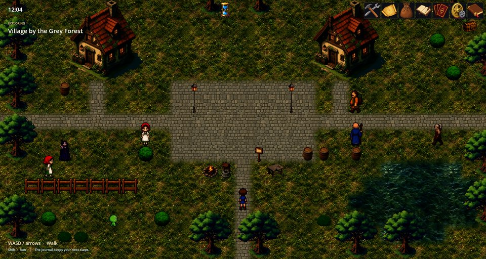

# Top-down Tiles — 正方形のマップビュー

Top-down Tiles は、クラシックな 2D RPG のスタイルで、正方形のグリッドに沿ってタイルマップを真上から描きます。共通エンジン Tile Rendering の 2 つのマップビューのうちの 1 つで、もう 1 つは Isometric Tiles です。RPG Plus はこのビューを使います。



## 何が変わり、何が変わらないか

この MOD はマスを画面のピクセルに変換します。各マスはマップの `TileSize`（既定 32 ピクセル）の正方形です。画像と形状は `rpg_object` で定義し、高さを変えても論理マスは変わりません。

ほかはすべて別の Mod の持ち物で、ビューを切り替えても変わりません。

- **マップとその中身** — タイル、建物、人、宝箱 — はコンテンツ Mod にあります（たとえば RPG Plus と Village Pack）。
- **歩行、衝突、イベント、バトル、セーブ**は RPG Mod の担当で、どちらのビューでも同じグリッドを使います。
- **描画、照明、時間の流れ**は Tile Rendering が行います。

矢印キーと WASD は、画面の上下左右に沿って動かします。


## 有効にする

ゲームの構成（**MOD とコレクション → コレクション → ゲーム → 構成を編集**）でこの Mod を含め、**マップの投影**を **見下ろし** にします。設定 `tile.renderer` の値は `topdown` です。

```json
"settings": { "tile.renderer": "topdown" }
```

1 回だけ試すなら、コマンドラインに `--tile-renderer=topdown` を付けます。このレンダラーだけを含み、設定を空のままにしたゲームでは、自動的に使われます。

## うまくいかないとき

1. **マップが空です。** ゲームの **マップの投影** が、含まれていないレンダラーを求めています。この Mod を含めるか、別の投影を選んでください。
